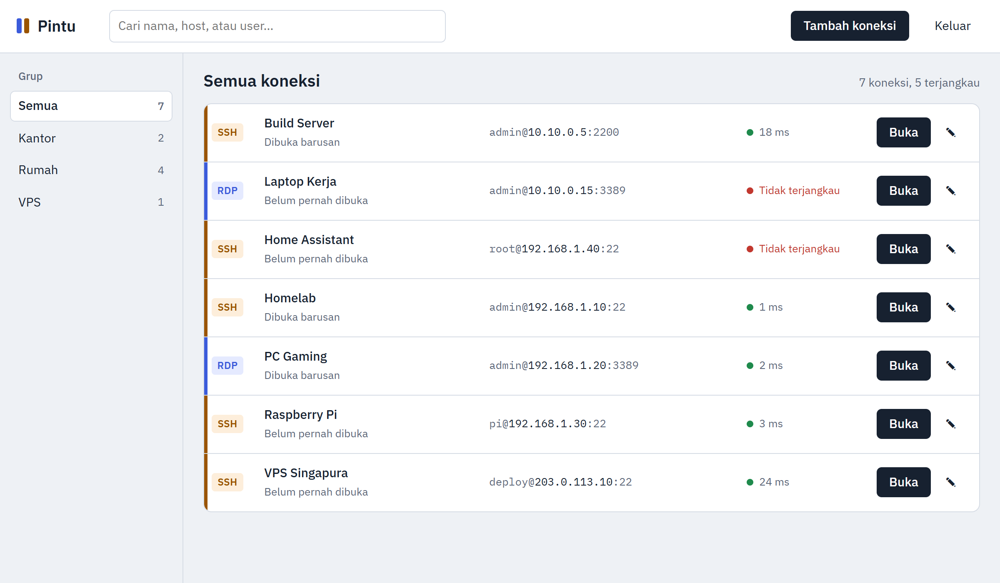
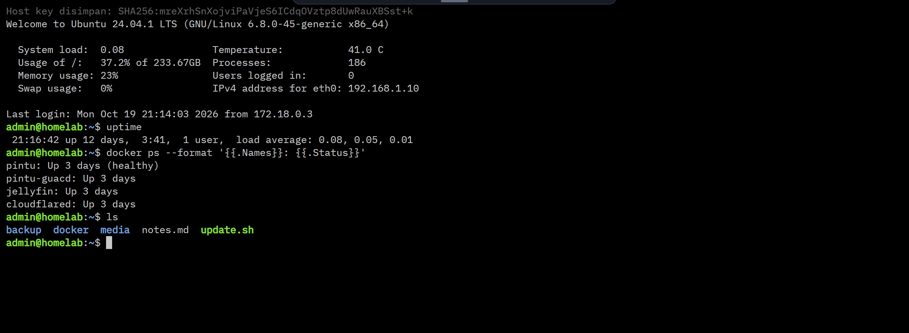
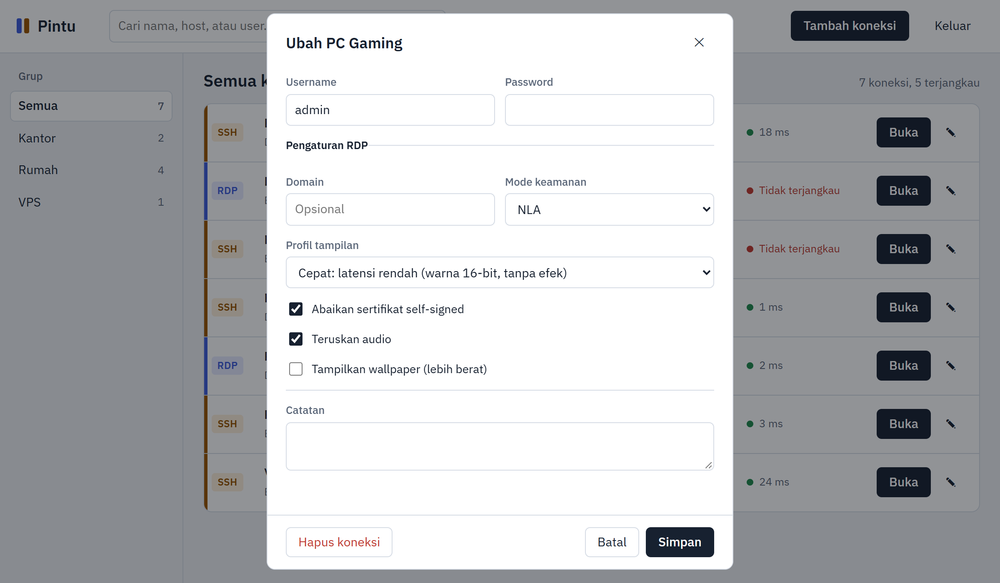
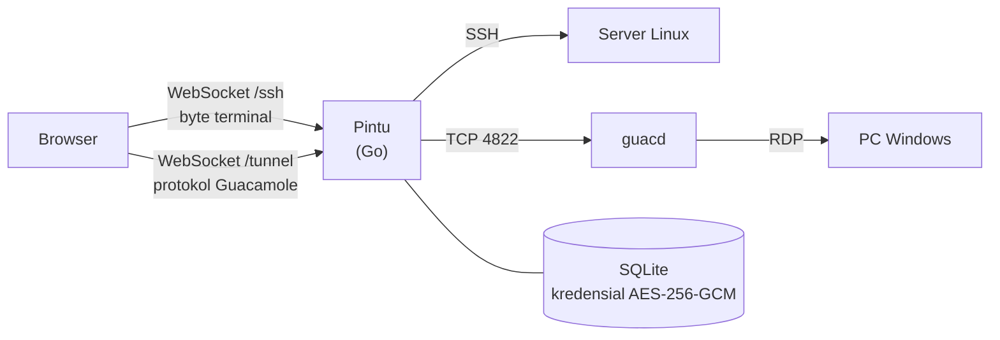

<p align="center">
  <picture>
    <source media="(prefers-color-scheme: dark)" srcset="docs/logo-dark.svg">
    
  </picture>
</p>

<p align="center">
  <b>Remote desktop manager self-hosted untuk RDP dan SSH, langsung dari browser.</b><br>
  Satu binary Go ±13 MB · SSH native berlatensi rendah · kredensial terenkripsi
</p>

<p align="center">
  
  
  
  
</p>

---

Pintu menyimpan daftar koneksi RDP dan SSH kamu di home server, lalu membuka sesinya di tab browser, tanpa client tambahan di laptop atau HP. Pasang di belakang Cloudflare Tunnel atau reverse proxy supaya PC dan server di rumah bisa diakses dari mana saja.

> **English:** Pintu ("door" in Indonesian) is a self-hosted, browser-based RDP and SSH manager written in Go. SSH is handled natively (x/crypto/ssh + xterm.js) for the lowest latency, and RDP goes through Apache Guacamole's `guacd`. The UI is in Indonesian.

<picture>
  <source media="(prefers-color-scheme: dark)" srcset="docs/screenshots/dashboard-dark.png">
  
</picture>

## Fitur

- **SSH native.** Byte terminal diteruskan apa adanya lewat WebSocket tanpa encode gambar, jadi latensinya mendekati SSH biasa. Mendukung password, private key + passphrase, dan keyboard-interactive.
- **Prompt seperti OpenSSH.** Kalau username atau password tidak disimpan, Pintu menanyakannya langsung di terminal.
- **Host key SSH dipin saat koneksi pertama (TOFU).** Kalau host key berubah, koneksi ditolak.
- **Terminal xterm.js** dengan render WebGL. Teks yang diseleksi otomatis tersalin, plus Ctrl+Shift+C / Ctrl+Shift+V.
- **RDP lewat `guacd`.** Mendukung domain, mode keamanan (NLA/TLS/RDP), abaikan sertifikat self-signed, audio, resolusi otomatis mengikuti ukuran tab, dan zona waktu mengikuti browser. Gambar dikirim dalam format WebP kalau browser mendukung.
- **Dua profil tampilan RDP.**
  - **Cepat** (default): warna 16-bit, tanpa font smoothing, tema, dan animasi.
  - **Kualitas**: warna 24-bit, font halus, dan tema Windows.
- **Dashboard.** Koneksi dikelompokkan per grup, ada pencarian (tekan `/`), dan status terjangkau + latency diperbarui tiap 30 detik.
- **Sesi di tab sendiri.** Layar penuh, Ctrl+Alt+Del, sinkron clipboard, dan dukungan layar sentuh.
- **Aman secara default.** Kredensial dienkripsi AES-256-GCM dan tidak pernah dikirim ke browser. Login dibatasi rate limit.

<p align="center">
  
  <picture>
    <source media="(prefers-color-scheme: dark)" srcset="docs/screenshots/rdp-settings-dark.png">
    
  </picture>
</p>

## Cara kerja



- **Pintu:** satu binary Go statis (tanpa CGO) dengan UI ter-embed. Image Docker-nya berbasis distroless, sekitar 23 MB.
- **SSH:** ditangani langsung oleh Pintu dengan `golang.org/x/crypto/ssh`.
- **RDP:** diteruskan ke [`guacd`](https://guacamole.apache.org/), proxy dari Apache Guacamole yang memakai FreeRDP. Belum ada implementasi RDP di Go yang cukup matang untuk NLA dan Windows 10/11. `guacd` hanya dibutuhkan kalau kamu memakai RDP.
- **Dari mana koneksi dibuka:** koneksi ke target dibuka oleh server, bukan oleh browser. Jadi target cukup bisa dijangkau dari server (misalnya LAN rumah).

## Mulai cepat

Butuh Docker dengan Compose plugin, git, dan openssl (shell Linux atau macOS).

```bash
git clone https://github.com/Ryandinulfatah12/pintu.git
cd pintu

cp .env.example .env
sed -i.bak "s/^SECRET_KEY=.*/SECRET_KEY=$(openssl rand -hex 32)/" .env && rm .env.bak
nano .env        # isi ADMIN_PASSWORD (minimal 8 karakter).
                 # Belum pakai HTTPS? Set COOKIE_SECURE=false dulu.

docker compose up -d --build
docker compose logs -f pintu
```

Compose hanya mem-publish Pintu di `127.0.0.1:7790`, jadi port itu tidak terbuka ke jaringan. Cek dari server dengan `curl http://127.0.0.1:7790/healthz`.

Untuk membuka UI dari laptop sebelum HTTPS siap, pakai SSH tunnel lalu buka `http://localhost:7790`:

```bash
ssh -L 7790:127.0.0.1:7790 user@server
```

Kalau Pintu diakses lewat HTTP biasa (bukan HTTPS), `COOKIE_SECURE` harus `false`, karena browser tidak menyimpan cookie `Secure` di HTTP. Setelah mengubah `.env`, jalankan ulang `docker compose up -d`.

## Konfigurasi

Semua konfigurasi lewat environment variable (file `.env` saat memakai Compose). `.env.example` sudah mengisi `COOKIE_SECURE=true` dan `LOG_LEVEL=ERRORS`, berbeda dari default di tabel ini.

| Variabel | Default | Keterangan |
|---|---|---|
| `SECRET_KEY` | **wajib** | Minimal 32 karakter. Dipakai untuk mengenkripsi kredensial dan menandatangani cookie. **Jangan diganti setelah ada data**: password yang tersimpan jadi tidak bisa dibuka. |
| `ADMIN_USER` | `admin` | Username login. |
| `ADMIN_PASSWORD` | **wajib** | Minimal 8 karakter. |
| `COOKIE_SECURE` | `false` | Set `true` kalau diakses lewat HTTPS. Dengan `true`, login hanya bisa lewat HTTPS. |
| `SESSION_HOURS` | `12` | Lama sesi login (jam). |
| `LOG_LEVEL` | `NORMAL` | `QUIET`, `ERRORS`, `NORMAL`, `VERBOSE`, atau `DEBUG`. |
| `PORT` | `8080` | Port HTTP. Pintu listen di semua interface; di Compose, port ini hanya dipublish ke `127.0.0.1:7790`. |
| `DATA_DIR` | `./data` di sebelah binary | Lokasi `pintu.db`. Di Compose: `/data` (volume `pintu-data`). |
| `GUACD_HOST` / `GUACD_PORT` | `127.0.0.1` / `4822` | Alamat `guacd`. Di Compose: `guacd:4822`. |

## Akses dari internet

Pasang HTTPS di depan Pintu, lalu set `COOKIE_SECURE=true`.

### Cloudflare Tunnel

Kalau `cloudflared` berjalan langsung di host dengan config lokal, tambahkan ke `/etc/cloudflared/config.yml`, di atas rule `http_status:404`:

```yaml
  - hostname: remote.example.com
    service: http://localhost:7790
```

Lalu restart `cloudflared` dan buat record DNS-nya:

```bash
cloudflared tunnel route dns <nama-tunnel> remote.example.com
```

Ada dua variasi setup:

- **Tunnel dikelola dari dashboard Zero Trust:** tambahkan Public Hostname di sana dengan service `http://localhost:7790`.
- **`cloudflared` berjalan di container:** sambungkan container-nya ke network Compose Pintu (biasanya `pintu_pintu`, cek dengan `docker network ls`), lalu pakai service `http://pintu:8080`.

WebSocket sudah didukung Cloudflare Tunnel tanpa setting tambahan.

**Sangat disarankan** memasang [Cloudflare Access](https://developers.cloudflare.com/cloudflare-one/applications/) (Zero Trust → Access → Applications) di depan hostname ini, misalnya hanya email kamu yang boleh masuk. Login Pintu sebaiknya jadi lapisan kedua, bukan satu-satunya.

### Caddy

```caddyfile
remote.example.com {
	reverse_proxy localhost:7790 {
		header_up X-Real-IP {remote_host}
		header_up CF-Connecting-IP {remote_host}
	}
}
```

### nginx

```nginx
server {
    listen 443 ssl;
    server_name remote.example.com;
    # ssl_certificate / ssl_certificate_key ...

    location / {
        proxy_pass http://127.0.0.1:7790;
        proxy_http_version 1.1;
        proxy_set_header Upgrade $http_upgrade;
        proxy_set_header Connection "upgrade";
        proxy_set_header Host $http_host;
        proxy_set_header X-Real-IP $remote_addr;
        proxy_set_header CF-Connecting-IP $remote_addr;
        proxy_read_timeout 1h;
    }
}
```

Di kedua contoh, header `X-Real-IP` dan `CF-Connecting-IP` ditimpa dengan IP asli klien karena rate limit login membaca header itu. Kalau tidak ditimpa, klien bisa mengirim header palsu untuk menghindari rate limit.

## Keamanan

- **Kredensial koneksi** (password, private key, passphrase) dienkripsi AES-256-GCM dengan kunci turunan dari `SECRET_KEY`, dan tidak pernah dikirim ke browser.
- **Tab sesi** hanya menerima token acak sekali pakai yang berlaku 60 detik.
- **Cookie login** ditandatangani HMAC-SHA256, dengan atribut `HttpOnly` dan `SameSite=Strict`, plus `Secure` kalau `COOKIE_SECURE=true`.
- **Endpoint WebSocket** `/ssh` dan `/tunnel` mewajibkan cookie login dan token sesi, dan menolak origin lain.
- **Rate limit login:** 5 kali gagal, IP dikunci 5 menit.
- **Host key SSH** dipin saat koneksi pertama. Kalau server memang diinstal ulang, klik ikon pensil (Ubah) di koneksi itu lalu **Simpan** untuk menerima key baru.
- **Satu akun admin.** Pintu dirancang untuk satu pemilik, bukan multi-user.
- **`guacd` tidak punya autentikasi.** Jangan pernah mem-publish port 4822 ke luar network Docker.

Menemukan celah keamanan? Mohon laporkan secara privat lewat tab **Security → Report a vulnerability** di GitHub, jangan lewat issue publik.

## Catatan koneksi

- **Target RDP Windows** harus edisi Pro, Enterprise, atau Server dengan Remote Desktop aktif. Windows Home tidak bisa jadi host RDP, tapi bisa jadi client.
- **Mode keamanan RDP:** kalau gagal dengan mode Otomatis, coba NLA (default Windows 10/11) atau TLS.
- **SSH ke home server itu sendiri:** pakai IP LAN-nya atau `host.docker.internal`.
- **Clipboard otomatis** butuh HTTPS dan izin clipboard di browser. Ini berlaku untuk sinkron clipboard RDP dan copy otomatis di SSH. Kalau tidak tersedia, pakai tombol **Clipboard** di toolbar atas (arahkan kursor ke tepi atas layar). Untuk SSH, tombol itu mengetikkan teks ke terminal.

## Backup

Semua data ada di volume `pintu-data`. Hentikan Pintu sebentar supaya database tersalin utuh, lalu simpan arsipnya di luar folder repo:

```bash
mkdir -p ~/backups
docker compose stop pintu
docker run --rm --volumes-from pintu -v ~/backups:/backup busybox \
  tar czf /backup/pintu-backup-$(date +%F).tgz -C /data .
docker compose start pintu
```

Simpan juga `SECRET_KEY` di tempat aman. Tanpa key yang sama, password dan private key di backup tidak bisa dibuka. Mengganti `SECRET_KEY` juga membuat semua sesi login keluar.

## Pengembangan

Butuh Go 1.24+. Tidak butuh CGO, karena SQLite memakai `modernc.org/sqlite`.

```bash
docker run -d --name guacd -p 127.0.0.1:4822:4822 guacamole/guacd:1.5.5   # hanya untuk RDP

# SECRET_KEY dibuat sekali lalu dipakai ulang, supaya kredensial di ./data tetap terbaca
[ -f .env.dev ] || echo "SECRET_KEY=$(openssl rand -hex 32)" > .env.dev
set -a; . ./.env.dev; set +a

DATA_DIR=./data ADMIN_PASSWORD=rahasia123 go run .
# buka http://localhost:8080
```

`go run .` listen di semua interface, jadi pakai password yang tidak dipakai di tempat lain. File di `public/` di-embed ke binary, jadi jalankan ulang `go run .` setelah mengubah UI.

Tes dan lint:

```bash
go vet ./...
go test ./...
```

Pintu awalnya ditulis di Node.js. `testdata/` memastikan database dan cookie dari versi lama tetap terbaca oleh versi Go.

```
main.go              config, routing, API koneksi
auth.go              login, cookie sesi bertanda tangan HMAC, rate limit
store.go             SQLite, enkripsi kredensial, validasi
session.go           token sesi sekali pakai, cek status terjangkau
ssh.go               sesi SSH native (WebSocket ⇄ x/crypto/ssh), TOFU host key
guac.go              tunnel RDP: handshake guacd + relay instruksi Guacamole
public/assets/       dashboard (app.js), sesi (session.js → rdp.js / ssh.js)
public/vendor/       guacamole-common-js 1.5.0, xterm.js 5.5.0 (+ addon fit 0.10, webgl 0.18)
testdata/            database dari versi Node.js untuk tes kompatibilitas
docs/                logo dan screenshot
```

Issue dan pull request dipersilakan. Jalankan `go vet ./...` dan `go test ./...` sebelum mengirim PR.

## Batasan saat ini

Satu akun admin, belum ada file transfer (SFTP / drive redirection), rekaman sesi, atau VNC.

## Lisensi

[MIT](LICENSE). Pintu menyertakan guacamole-common-js (Apache-2.0) dan xterm.js (MIT). Rinciannya ada di [THIRD_PARTY_NOTICES.md](THIRD_PARTY_NOTICES.md).
